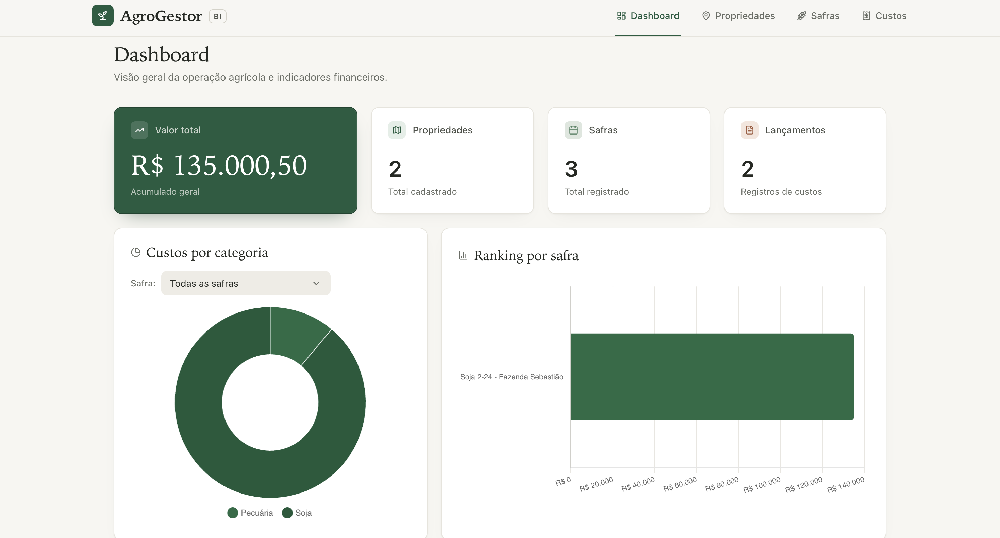
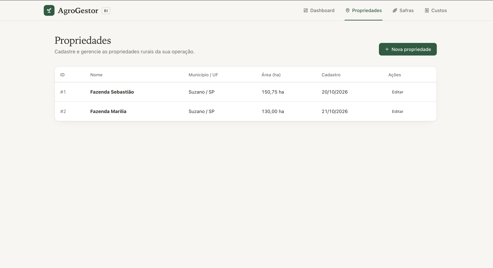
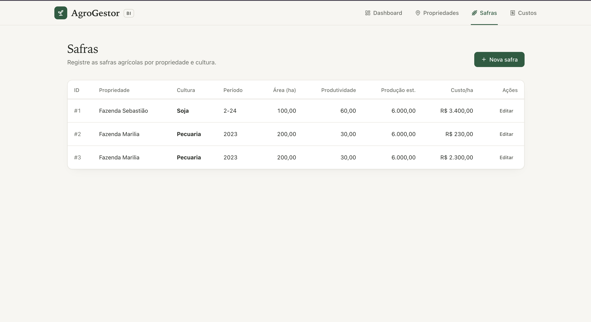
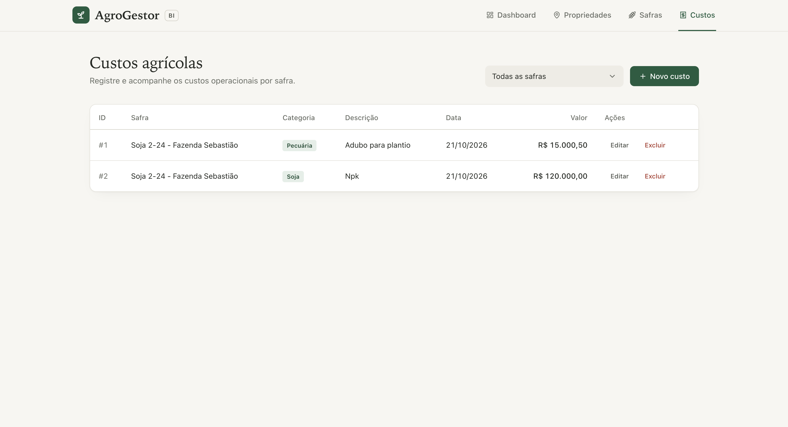

# 🌱 AgroGestor-BI

### Gestão agrícola com Java, Spring Boot e MySQL

Uma aplicação web desenvolvida para demonstrar o gerenciamento de propriedades rurais, safras agrícolas e custos operacionais, reunindo informações em um dashboard com indicadores e gráficos para facilitar o acompanhamento da operação agrícola.

**Desenvolvido por Matheus Vinicius Carvalho**, estudante de Engenharia de Software e entusiasta de tecnologia e agronegócio.

---

## 📊 Demonstração do sistema

O AgroGestor-BI possui uma interface voltada à visualização de informações agrícolas e financeiras, com navegação entre dashboard, propriedades, safras e custos.

### Dashboard

Visão geral dos indicadores, valores registrados e gráficos de custos por categoria e ranking por safra.



### 🏡 Propriedades

Área destinada ao gerenciamento das propriedades rurais cadastradas no sistema.



### 🌾 Safras

Gerenciamento e acompanhamento das safras vinculadas às propriedades rurais.



### 💰 Custos

Registro e acompanhamento dos custos relacionados à operação agrícola.



---

## ✨ Funcionalidades

- 📈 **Dashboard:** visualização de indicadores e gráficos da operação agrícola.
- 🏡 **Propriedades:** cadastro, consulta e edição de propriedades rurais.
- 🌾 **Safras:** gerenciamento dos registros das safras agrícolas.
- 💰 **Custos:** registro e gerenciamento de custos operacionais.
- 📊 **Indicadores financeiros:** acompanhamento de valores e custos registrados.
- 🔎 **Filtros e visualizações:** consulta de informações para facilitar a análise dos dados.

---

## 🛠️ Tecnologias utilizadas

| Tecnologia | Aplicação no projeto |
|---|---|
| Java | Linguagem de programação do backend |
| Spring Boot | Estrutura da aplicação backend |
| Spring Data JPA / Hibernate | Persistência e mapeamento de dados |
| MySQL | Banco de dados relacional |
| HTML5 | Estrutura da interface |
| CSS3 | Estilização da interface |
| JavaScript | Interatividade do frontend |
| Maven | Gerenciamento de dependências e execução |
| Git e GitHub | Versionamento e hospedagem do código |

---

## 🗂️ Estrutura do projeto

```text
AgroGestor-BI/
├── database/
│   └── schema.sql
├── frontend/
│   ├── css/
│   │   └── style.css
│   ├── index.html
│   └── js/
│       └── app.js
├── src/
│   ├── main/
│   │   ├── java/
│   │   │   └── com/agrogestor/bi/
│   │   │       ├── controller/
│   │   │       ├── dto/
│   │   │       ├── exception/
│   │   │       ├── model/
│   │   │       ├── repository/
│   │   │       └── service/
│   │   └── resources/
│   │       ├── static/
│   │       └── application.properties
│   └── test/
├── dashboard.png
├── propriedades.png
├── safras.png
├── custos.png
├── pom.xml
├── mvnw
├── mvnw.cmd
├── .gitignore
├── HELP.md
└── README.md
```

---

## 🚀 Como executar o projeto

### Pré-requisitos

Antes de começar, você precisará de:

- Java compatível com a versão configurada no `pom.xml`.
- Maven instalado, caso opte por executar com o comando `mvn`.
- MySQL instalado e em execução.

### 1. Clone o repositório

```bash
git clone https://github.com/matheusvccarvalho/AgroGestor-BI.git
```

Entre na pasta do projeto:

```bash
cd AgroGestor-BI
```

### 2. Configure o banco de dados

Execute o script `database/schema.sql` no MySQL para criar a estrutura inicial do banco de dados.

Por padrão, a aplicação utiliza o banco `agrogestor_bi`.

### 3. Configure as credenciais

Configure as variáveis de ambiente de acordo com seu ambiente MySQL:

```bash
DB_URL=jdbc:mysql://localhost:3306/agrogestor_bi
DB_USERNAME=seu_usuario
DB_PASSWORD=sua_senha
```

Substitua os valores pelas credenciais do seu banco de dados.

### 4. Inicie a aplicação

Com o Maven instalado, execute:

```bash
mvn spring-boot:run
```

### 5. Acesse o sistema

Após a inicialização, abra o navegador em:

[http://localhost:8080](http://localhost:8080)

---

## 📌 Indicadores demonstrativos

O dashboard apresenta informações relacionadas a:

- Valor total registrado.
- Quantidade de propriedades cadastradas.
- Quantidade de safras registradas.
- Quantidade de lançamentos de custos.
- Custos por categoria.
- Ranking financeiro por safra.

**Importante:** os dados e valores apresentados nas capturas de tela são demonstrativos e não representam dados financeiros reais de uma propriedade rural.

---

## 🔭 Próximos passos

O projeto poderá evoluir com novas funcionalidades, como:

- Ampliação dos indicadores de produtividade agrícola.
- Relatórios gerenciais e exportação de dados.
- Melhorias na experiência de uso e visualização.
- Integração futura com ferramentas de Business Intelligence, como Power BI.
- Novos recursos para apoiar a análise da gestão rural.

Esses itens representam possibilidades de evolução, não funcionalidades necessariamente implementadas na versão atual.

---

## 🎯 Objetivo do projeto

O AgroGestor-BI foi desenvolvido como um projeto prático de aprendizado e aplicação de conceitos de desenvolvimento de software, integração com banco de dados e visualização de informações.

A proposta é explorar como a tecnologia pode contribuir para uma gestão agrícola mais organizada, conectando desenvolvimento de software e agronegócio.

---

## 👨‍💻 Desenvolvedor

**Matheus Vinicius Carvalho**

Estudante de Engenharia de Software, com interesse em desenvolvimento de software, dados, automação e soluções tecnológicas para o agronegócio.

[](https://github.com/matheusvccarvalho)

[](https://www.linkedin.com/in/matheus-vinicius-carvalho-26485122a/)

---

<p align="center">
  🌱 <strong>AgroGestor-BI</strong><br>
  Tecnologia, organização e informação para a gestão agrícola.
</p>
